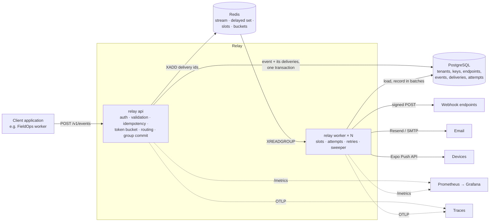
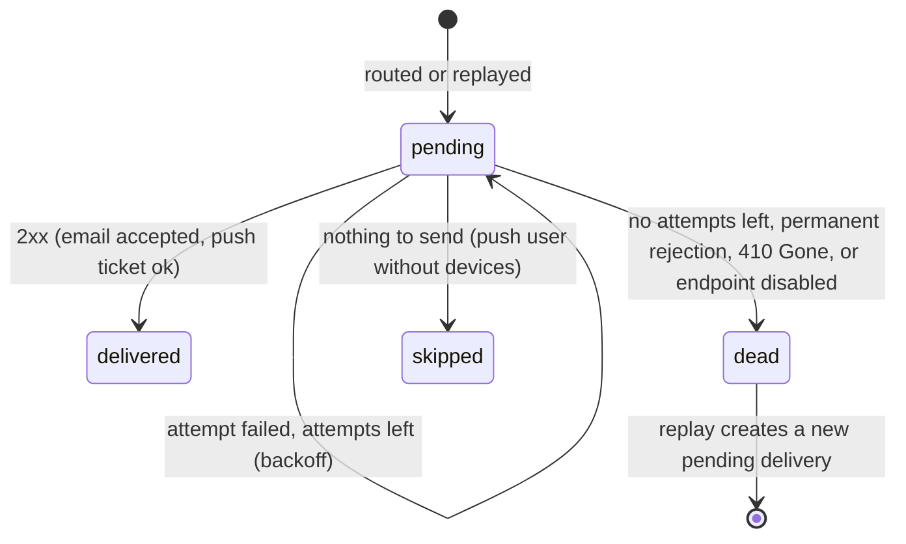

# Architecture

Relay is one Go binary with two roles, `relay api` and `relay worker`, around PostgreSQL (state) and Redis
(queues and limits). Both roles are stateless and scale horizontally.



## An event's life

```mermaid
sequenceDiagram
    participant App as Client
    participant API as relay api
    participant PG as PostgreSQL
    participant R as Redis
    participant W as relay worker
    participant X as Receiver
    App->>API: POST /v1/events (Idempotency-Key)
    API->>R: token bucket (tenant ingest rate)
    API->>API: route: the tenant's subscriptions (cached) → deliveries
    API->>PG: one transaction for every request waiting: INSERT events, INSERT their deliveries
    API->>R: XADD relay:deliveries
    API-->>App: 202 Accepted {id}
    W->>R: XREADGROUP relay:deliveries (as many as it has free slots)
    W->>R: endpoint slot + tenant slot + delivery token per delivery, with a lease (pipelined Lua)
    W->>PG: load the deliveries still pending and due (one query)
    W->>X: POST, signed (10 s timeout)
    X-->>W: 2xx / error
    W->>PG: record attempts and next states (batched)
    W->>R: release slots (wakes a parked delivery) or ZADD relay:delayed for a retry; XACK + XDEL
```

**Group commit.** The API stores events through a few flushers: each takes every request waiting at that
moment and writes their events and deliveries with one statement each, in one transaction. One commit (one WAL
flush) then covers many requests, and the API answers `202` only after it. With little traffic a batch holds a
single event; under load batches grow on their own, so ingestion latency stays flat as the rate rises. The worker
records attempt results the same way.

## Delivery states



## Pieces

| Package | Does |
|---|---|
| `cmd/relay` | Subcommands: `api`, `worker`, `all`, `migrate`, `keys create`, `healthcheck`, `sink`, `version` |
| `internal/api` | chi router, authentication and scopes, RFC 9457 errors, cursor pagination, routing at ingestion, the group-commit event writer, every handler |
| `internal/worker` | The delivery loop (bounded by `WORKER_CONCURRENCY`), batched loading and recording, retries and backoff, endpoint disabling, the sweeper, parking-lot recovery, push receipts, retention |
| `internal/router` | Pure fan-out logic: which subscriptions match an event and which deliveries it becomes |
| `internal/queue` | Redis Streams, the delayed set, token buckets and concurrency slots (Lua scripts in `scripts/`) |
| `internal/channels/*` | Webhook (signing, SSRF guard, timeouts), email (Resend, SMTP, log) and push (Expo) senders |
| `internal/store` | pgx pool, goose migrations, queries generated by sqlc from `queries/*.sql` |
| `pkg/webhook` | Public Standard Webhooks signing and verification for receivers written in Go |
| `api/openapi.yaml` | The OpenAPI 3.1 contract, served at `/openapi.yaml` and `/docs`, enforced by the integration tests |

An attempt in progress is not written to PostgreSQL: the worker holds the delivery's slot in Redis with a
lease, and writes once, when the result is known. That keeps every delivery to one insert and one update per
attempt. If the worker dies mid-attempt, the delivery is still `pending` and its stream entry unacknowledged;
another worker takes the entry over once the lease has passed (`XAUTOCLAIM`).

## Guarantees and their limits

- **At least once.** A delivery is recorded only after the receiver answers. A crash in between sends it
  again, with the same `webhook-id`. Receivers deduplicate on it.
- **No lost events.** An event and its deliveries are committed to PostgreSQL before `202`. If Redis loses its
  data, the sweeper finds the overdue deliveries in PostgreSQL ([ADR 001](adr/001-redis-streams.md)).
- **Ordering is not guaranteed.** Deliveries to one endpoint run concurrently (up to its `max_in_flight`) and
  retries reorder them. Set `max_in_flight` to 1 for best-effort order; use the event's `created_at` to order
  for certain.
- **Isolation.** Every query is scoped by tenant. Keys bound to a tenant can't see others (they get `404`).
  Limits are per tenant and per endpoint, so a slow or failing endpoint holds only its own slots.
- **Retries.** 8 attempts within about 23 hours: waits of 75 s, 3.8 min, 11 min, 34 min, 1.7 h, 5.1 h and
  15.2 h at most, each shortened by up to a quarter at random. A `Retry-After` from the receiver is respected
  (up to 16 hours). Then the dead-letter queue, from which deliveries are replayed by hand.
- **Automatic disabling.** A webhook endpoint whose attempts have all failed for 24 hours (and at least 10 in a
  row) is disabled and its pending deliveries are dead-lettered; `410 Gone` disables it at once. Enabling it
  and replaying its dead letters resumes delivery.
- **Graceful shutdown.** On `SIGTERM` the API stops accepting and finishes its requests; workers stop reading
  and wait up to `SHUTDOWN_TIMEOUT` (30 s) for attempts in progress to be recorded.

## Security

- API keys are 238-bit random strings stored as SHA-256 hashes; webhook secrets are encrypted at rest with
  AES-256-GCM.
- Webhook URLs must be public: hostnames like `localhost` and private, loopback, link-local, CGNAT and other
  reserved addresses are refused when an endpoint is saved, and the dialer checks the resolved address again
  on every connection, so DNS rebinding can't reach internal services. Redirects are not followed.
- Request bodies are capped at 512 KB, unknown JSON fields are rejected, and every API key is limited to 50
  requests a second outside ingestion.
- The landing page and docs send a Content Security Policy; API responses are `no-store`.
- Containers run as non-root on a distroless image with a read-only filesystem and no Linux capabilities.
