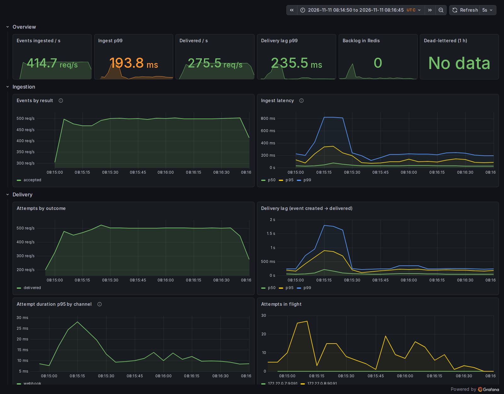

# Load test

Relay ran on **two pinned CPU cores** (PostgreSQL, Redis, one API and one worker process together) on a shared
4-vCPU server, with production durability: every event committed to disk before its `202`, every event delivered
as a signed webhook. Load from k6 at a constant arrival rate for two minutes per run, 11 November 2026, Relay 1.0.0.

| | 500 events/s (run A) | 500 events/s (run B) | 300 events/s |
|---|---|---|---|
| Events accepted (`202`) | 59,487 · **495/s** | 59,766 · **497/s** | 35,798 · 298/s |
| Failed requests | **0** | **0** | **0** |
| Webhooks delivered, signed and verified | **59,487 · 496/s** | **59,766 · 499/s** | 35,798 · 299/s |
| Duplicates · bad signatures | 0 · 0 | 0 · 0 | 0 · 0 |
| Backlog left when the load stopped | none (0 s) | none (0 s) | none (0 s) |
| Ingest latency p50 · p95 · p99 (k6) | 33.8 · 156.4 · 280.8 ms | 21.4 · 78.9 · 187.2 ms | 18.7 · 69.7 · 164.6 ms |
| Delivery lag p50 · p95 · p99 (ingest → webhook received) | 38 · 226 · 599 ms | 26 · 90 · 293 ms | 23 · 66 · 173 ms |
| Relay CPU, mean (200% = both cores) | 170% | 164% | 163% |
| k6 iterations not started on time | 514 (0.9%) | 234 (0.4%) | 202 (0.6%) |

Raw results (k6 summaries, sink counts, CPU samples, the slowest statements) are in [`docs/loadtest/`](loadtest/).



### Against the targets (PRD §11.2)

- **Throughput of at least 500 events a second on two vCPUs: met.** Both runs at 500/s accepted and delivered
  every event, signed and once, and the queue was empty the moment the load stopped. Relay used about 165–170%
  of its two cores.
- **p99 ingest latency under 50 ms: not met at these rates on this host.** The median is 20–35 ms and p95 70–160 ms,
  but p99 is 165–280 ms, both at 300 and at 500 events a second. A 50-events-a-second probe on the same host (same stack, not pinned) gave
  p50 9.0 ms, p95 14.9 ms and **p99 22.7 ms**. Two things set the tail: the first 25 seconds of each run (cold
  caches and connection pools; the spike on the dashboard), and the four Relay processes competing for two cores
  that the host's other services also run on (its load average stayed between 3 and 16 during the runs). A dedicated
  2-vCPU machine, or PostgreSQL on cores of its own, is the next measurement.

### What the load test changed

The first run of the first design topped out near **200 events a second with a p99 over one second**, and
PostgreSQL backends were OOM-killed at 256 MB. Profiling with `pg_stat_statements` led to the design in
[ADR 001](adr/001-redis-streams.md):

| Change | Why |
|---|---|
| PostgreSQL 384 MB, separate pools for the API (synchronous commits) and the worker (asynchronous commits) | 70 connections met a 256 MB limit; worker writes don't need to wait for the disk (a lost write repeats an attempt) |
| An attempt is held by its Redis slot, not by an `UPDATE` before it | halves the writes per delivery |
| Fewer indexes on `deliveries`, lazy expiry of idempotency keys, `wal_compression` | index maintenance and WAL were most of PostgreSQL's time |
| Routing at ingestion, in the event's own transaction | removes a second stream, a routing stage and an `UPDATE` per event |
| Group commit in the API and the worker (shared statements and commits, a 2–10 ms gather window) | per-statement cost dominated with one event per statement |

Remaining ideas, in order of expected gain: take the ingest token bucket per batch instead of per request (one
Redis call per request today), make the attempt `UPDATE` a HOT update (no index changes), and run PostgreSQL on its
own cores.


## Method

`loadtest/run.sh` builds the image and starts a throwaway stack from `compose.yaml` with the overlay in
`loadtest/compose.yaml`:

- **Relay on two CPUs.** PostgreSQL 18, Redis 8, one API process and one worker process are all pinned to the
  same two cores (`cpuset: "2,3"`), the shape of a 2-vCPU virtual machine. Memory limits are the production
  ones: API 128 MB, worker 192 MB, PostgreSQL 384 MB, Redis 128 MB.
- **Load on the other cores.** k6, the webhook sink, Prometheus and Grafana run on cores 0 and 1, so they don't
  take Relay's CPU time.
- **Durability as in production.** The API commits every event synchronously (`fsync=on`), so a `202` means the
  event is on disk; the worker commits asynchronously, as in production (a lost write only repeats an attempt);
  Redis keeps its append-only file. Nothing is tuned for the benchmark.
- **The load:** a constant arrival rate of `POST /v1/events` (k6 `constant-arrival-rate`), each request with its
  own `Idempotency-Key` and a 700-byte payload shaped like a FieldOps `job.completed` event. Each event matches
  one webhook subscription, so every event is also one signed webhook to the sink.
- **The sink** (`relay sink`) verifies every signature, counts unique `webhook-id`s and measures the lag from the
  event's `created_at` to its arrival.
- **Pass criteria** (k6 thresholds): p99 of ingestion under 50 ms, under 0.1% failed requests, fewer than 10
  dropped iterations; then every accepted event must reach the sink, signed, once.

Server-side latency comes from Relay's own histogram (`relay_ingest_duration_seconds`, scraped by Prometheus);
client-side latency from k6. CPU use is sampled every two seconds with `docker stats` (200% = both cores busy).

The host is a shared 4-vCPU server that runs other services at the same time, so the numbers are a floor rather
than a best case.

## Run it

```bash
loadtest/run.sh                          # 600 events/s for 2 minutes
RATE=800 DURATION=5m loadtest/run.sh     # other rates and durations
KEEP=1 loadtest/run.sh                   # keep the stack (Grafana on http://127.0.0.1:13300)
```

Results land in `loadtest/results/<time>/`: the k6 summary, the sink's counts, the Prometheus queries, the CPU
samples and a `report.md` table.
